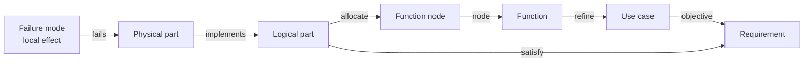

# FMEA and FMECA

This tutorial explains what an FMEA and an FMECA are, how SysML Viewer's toolbox links them to
the SysML model, how to use the command line, and how to look at the results. All examples come
from the Electric Car project (`examples/electric_car`).

## FMEA versus FMECA

**FMEA** (failure mode and effects analysis) asks: *what can fail, what happens when it does, and
how bad is that?* It is **qualitative**. Every failure mode gets three scores from 1 to 10 and
their product is the risk priority number:

- **S**, severity of the end effect;
- **O**, occurrence, how likely the failure mode is;
- **D**, detection, how likely it is to go unnoticed (10 means "never detected").

**FMECA** adds the **C** for criticality. It is **quantitative** (MIL-STD-1629A style): instead of
a judged O it uses failure rates, and it ranks modes by severity class and calculated criticality.

| | FMEA (`--mode fmea`) | FMECA (`--mode fmeca`) |
|---|---|---|
| Question | Which modes are the riskiest? | How much risk does each mode contribute during the mission? |
| Per failure mode | `occurrence` (or a rate that is translated) and `detection.score` | `mode_ratio` and `effect_probability` |
| Per item or sub-unit | nothing | `rate_fit`, the failure rate in FIT (failures per 10^9 hours) |
| Result | S, O, D and RPN = S x O x D | C_m, C_r (per item and class), severity class and probability level |
| Ranking | RPN, highest first | Severity class (I first), then C_m |

Use the **FMEA** early, when you have no rate data and want to find the worst problems by judgement.
Use the **FMECA** when you have rates (handbooks, supplier data, field data) and want numbers you can
compare, sum and simulate. Both work from the same data files; `--mode` decides which fields are required.

## Effect levels

A failure mode starts in a part and travels upwards. An FMEA names three levels:

| Level | Meaning | Where it comes from |
|---|---|---|
| **Local effect** | What the failure does to the part itself: `loss`, `degraded` (with a fraction) or `erroneous` | You write it in the YAML data |
| **Next higher effect** | Which logical parts and functions are affected | Computed from the SysML model |
| **End effect** | Which use cases and requirements are affected | Computed from the SysML model |

The tool only asks you for the local effect. The two higher levels are **computed**, so they cannot be
mistyped or go stale.

## Severity, occurrence, detection and RPN

**Severity (S)** is derived, not typed. For every requirement that is at risk, the tool takes the score
of the requirement's group (`Safety` is 10, `Performance` 6, ...) and multiplies it by a factor for the
status (`LOST` is 1.0, `DEGRADED` is 0.6). S is the highest result, rounded half up and limited to 1-10.
A mode that endangers no requirement has S = 1.

**Occurrence (O)** is either written directly (`occurrence: 4`) or derived from the mode's failure rate
through a table in `severity.yaml` (the `occurrence_scale`).

**Detection (D)** is always written: `detection: { method: ..., score: ... }`.

**RPN = S x O x D.** For `winding_open` in the electric motor: S = 10 (the motor loss takes down
`BrakingDistance`, a Safety requirement), O = 4, D = 5, so RPN = 200.

## Criticality

FMECA works with rates. For one failure mode:

- lambda_p is the failure rate of the item or sub-unit, `rate_fit`;
- alpha is the **mode ratio**: the share of lambda_p that shows up as this mode (the ratios of one item add up to at most 1);
- beta is the **effect probability**: the chance that the mode really has the end effect;
- t is the **mission time** in hours.

**C_m = lambda_p x alpha x beta x t** (with lambda_p in failures per hour, so FIT x 10^-9). For
`winding_open`: 100 FIT x 0.8 x 1.0 x 10 000 h = 8.0e-4. **C_r** is the sum of the C_m of an item's failure modes within one severity class (MIL-STD-1629A); the
FMECA report has a table with C_r per item and class. Both C_m and C_r are per instance: for a group such as the
eight battery modules (`Qty` 8), multiply by `Qty`.

Two classifications place each mode in a matrix:

- **Severity class** from S, in `severity.yaml`: I for S 9-10, II for 7-8, III for 4-6, IV for 1-3.
- **Probability level** from C_m: A for 0.2 or more, B 0.1, C 0.01, D 0.001, E below that.

The report shows this matrix, with the failure modes in the cells, and a chart of C_m against severity.
Class I with a high probability level (top left of the matrix) is where you act first.

## Why link the FMEA to the model

An FMEA is traditionally a spreadsheet. The effect columns are typed by hand, so they drift when the
design changes, and nobody can see which rows a change invalidates.

Here the FMEA is data **on top of** the SysML model, and everything above the local effect is computed
from the architecture. A design change therefore changes the table without touching the FMEA data.

Example. The functional model says that losing `SpeedControl` hurts `Maneuvrability`, and that
`Maneuvrability` is needed by `Lighting` through an `#Indicate` dependency:

[//]: # (source: examples/electric_car/functions/functions.sysml)
```sysml
#Indicate dependency from Lighting to Maneuvrability;
```

Because of that line, the failure mode `psu_dead` in the drive computer also loses `Lighting`, and the
requirement `NightVisibility` is at risk. Delete the line, run `analyze` again, and `Lighting` and
`NightVisibility` drop out of the effect columns. You did not edit a single FMEA row.

## What lives in SysML and what lives in YAML

| In the SysML model (design facts) | In the FMEA data (YAML) |
|---|---|
| Parts, hierarchy, `#implements`, `allocate`, function dependencies | Failure modes per part definition or part |
| Redundancy: `#Pool`, `#Redundant`, multiplicity, `required` | Failure rates (FIT), mode ratios, effect probabilities |
| Capacity attributes such as `capacityKWh` | Detection method and score, mitigation |
| | The local effect of each mode |
| | Sub-units (SRUs) that are not modelled in SysML |
| | Severity groups and classification tables |

The rule of thumb: **if a change alters how the system is built, it belongs in SysML. If it alters how
it fails, it belongs in the FMEA data.** Redundancy is a design decision, so it stays in the model and a
data file cannot quietly change the architecture.

## How effects propagate

The tool builds an impact graph from the model and lets a failure flow upwards:



At every step the tool tracks a capability between 0 and 1: 1 is **OK**, between is **DEGRADED**, 0 is
**LOST**. A node gets the minimum of what it depends on, with these rules:

- **Containment.** A failed parent takes down its children (a broken ECU takes down its software), but not the other way round.
- **`#Pool`.** A group of parts that together provide a capacity. Losing 1 of 8 battery modules leaves 7/8 of the capacity: the battery is DEGRADED, and it is LOST only when the surviving capacity drops below `required`.
- **`#Redundant`.** k of n: the set works while at least k members survive. With two brake circuits and `required = 1`, one leak does not lose braking, but the tool flags `redundancy exhausted`.
- **`#Soft` dependencies** between functions only pass on part of the damage (never below 0.5). Ordinary dependencies pass on all of it.
- **Erroneous** behaviour is treated as loss, and the row gets the flag `erroneous as loss`.

The pool and the redundant set are ordinary SysML in the physical architecture:

[//]: # (source: examples/electric_car/physical_architecture/vehicle_physical.sysml)
```sysml
#Pool part modules[8] : BatteryModule {
  doc /* Eight battery modules. Their capacities add up to 60 kWh, and the pack counts as available while at least 45 kWh survive. */
}
attribute required = 45;
```

[//]: # (source: examples/electric_car/physical_architecture/vehicle_physical.sysml)
```sysml
#Redundant part brakeCircuits[2] : BrakeCircuit {
  doc /* Two brake circuits. One of them is enough to brake, so the set tolerates a single failure. */
}
attribute brakeCircuitsRequired = 1;
```

The `#implements` dependencies tie the groups to the logical architecture, which is how a module
failure reaches the functions:

[//]: # (source: examples/electric_car/physical_architecture/vehicle_physical.sysml)
```sysml
#implements dependency from batteryPack.modules to LogicalArchitecture::Car::battery;
#implements dependency from brakeCircuits to LogicalArchitecture::Car::frictionBrakes;
```

The same engine is available on its own, for what-if questions without any FMEA data (see the command line section).

## The data format

The data lives in `<project>/fmea/`. Each file starts with a `# yaml-language-server: $schema=...`
comment, so an editor with a YAML extension offers completion and error markers.

| File | Content |
|---|---|
| `library/<name>.yaml` | Failure modes for a **part definition**. They apply to every part usage typed by it. |
| `instances.yaml` | Failure modes for individual part usages, including sub-units (`srus`). |
| `severity.yaml` | Severity groups, status factors, classes, levels and mission time. |

A library file gives the modes of a part definition, here one module of the battery pack. It applies to
all eight modules at once:

[//]: # (source: examples/electric_car/fmea/library/battery_module.yaml)
```yaml
part_def: PhysicalArchitecture::BatteryModule
rate_fit: 500
failure_modes:
  - id: cell_short
    description: Internal short circuit in a cell
    local_effect: { kind: loss }
    mode_ratio: 0.25
    effect_probability: 1.0
    occurrence: 5
    detection: { method: BMS cell voltage monitoring, score: 3 }
```

`instances.yaml` handles single parts. The drive computer is one unit in SysML, but its power supply and
CAN transceiver are not modelled, so they are written as sub-units (SRUs). Their failure modes give a
local effect on the computer:

[//]: # (source: examples/electric_car/fmea/instances.yaml)
```yaml
- part: PhysicalArchitecture::VehiclePhysical::driveEcu
  srus:
    - id: powerSupply
      rate_fit: 50
      failure_modes:
        - id: psu_dead
          description: Supply voltage lost
          local_effect: { kind: loss }
          mode_ratio: 1.0
          effect_probability: 1.0
          occurrence: 3
          detection: { method: Supply monitor, score: 2 }
```

`severity.yaml` makes severity something the tool derives:

[//]: # (source: examples/electric_car/fmea/severity.yaml)
```yaml
requirement_groups: { Safety: 10, Security: 8, Performance: 6, Comfort: 3, Size: 2 }
status_factor: { LOST: 1.0, DEGRADED: 0.6 }
default_group_score: 1
spof_severity_threshold: 8
mission_time_h: 10000
```

The `id` of a mode must match `^[a-z][a-z0-9_]*$`, unknown keys are errors, and the `mode_ratio` values of
one item or sub-unit may not add up to more than 1. `fmea.py schema --write` regenerates the JSON Schemas in
`docs/schemas/`.

## Adding a failure mode

Brake circuits are the simplest file. This is the whole library for them:

[//]: # (source: examples/electric_car/fmea/library/brake_circuit.yaml)
```yaml
part_def: PhysicalArchitecture::BrakeCircuit
rate_fit: 30
failure_modes:
  - id: hydraulic_leak
    description: Fluid leak in one brake circuit
    local_effect: { kind: loss }
    mode_ratio: 1.0
    effect_probability: 1.0
    occurrence: 3
    detection: { method: Brake fluid level and pressure sensor, score: 4 }
```

Say you want to add worn brake pads. Follow these steps in `fmea/library/brake_circuit.yaml`:

1. **Make room in the failure rate.** The mode ratios of an item add up to at most 1, and the leak already takes all of it. Lower the leak's share:

[//]: # (illustration: lower the existing mode ratio)
```diff
-    mode_ratio: 1.0
+    mode_ratio: 0.6
```

2. **Append the new mode** at the end of `failure_modes`. The local effect is `degraded` with a fraction between 0 and 1, here a braking capacity of 70 percent:

[//]: # (illustration: the new mode)
```yaml
  - id: pad_wear
    description: Friction lining worn down
    local_effect: { kind: degraded, fraction: 0.7 }
    mode_ratio: 0.4
    effect_probability: 1.0
    occurrence: 4
    detection: { method: Pad wear sensor, score: 3 }
```

3. **Check it.** `fmea.py validate examples/electric_car` must say `0 errors`. A typo in a key, a missing score or a mode ratio sum above 1 is reported with file and line.
4. **Read the effect.** `fmea.py analyze examples/electric_car --mode fmea` now has a `pad_wear` row. You did not write its next higher or end effect; the tool computed them from the model.
5. **Regenerate the reports** (next sections), so the committed ones stay current.

A mode on a part definition applies to every usage of it. To give one usage a different value, use an
`overrides` entry in `instances.yaml`.

## Command line

Run everything from the repository root.

**Failure impact without FMEA data**, one or several faults at a time:

```bash
backend/.venv/bin/python scripts/failure_impact.py examples/electric_car --fail electricMotor:loss
backend/.venv/bin/python scripts/failure_impact.py examples/electric_car --fail batteryPack.modules:loss:2
backend/.venv/bin/python scripts/failure_impact.py examples/electric_car --spof --format markdown
```

**The FMEA/FMECA tool** `scripts/fmea.py`:

| Command | What it does |
|---|---|
| `validate [--mode fmea\|fmeca\|both] [--notes]` | Checks the data against the model and the mode's required fields. |
| `coverage` | Lists physical parts without failure modes, modes without a trace, requirements without a group. It also warns about short references (a `part` or `part_def` that is not fully qualified) and about libraries that no longer apply to any part (`unused-library`). |
| `analyze --mode fmea\|fmeca [--format markdown\|csv\|json] [--spof]` | The table, or only the single points of failure. |
| `analyze ... --out [DIR]` | Writes `<mode>-table.csv`, `<mode>-spof.csv`, `coverage.csv` and `<mode>-report.md` to a folder (default `<project>/fmea/docs/`). |
| `analyze --mode fmeca --out --trials N --seed S` | The same, plus a Monte Carlo simulation (`simulation.csv` and a report section). |
| `simulate [--trials N] [--seed S] [--mission-time H]` | Probability that functions, use cases and requirements are LOST or DEGRADED within the mission time. |
| `schema [--write]` | The JSON Schemas of the data files. |

```bash
backend/.venv/bin/python scripts/fmea.py validate examples/electric_car
backend/.venv/bin/python scripts/fmea.py analyze examples/electric_car --mode fmeca --format csv
backend/.venv/bin/python scripts/fmea.py simulate examples/electric_car --trials 5000 --seed 1
```

`analyze` and `simulate` validate first and stop, with exit code 1, if the data and the model disagree.
Exit codes: 0 ok, 1 drift or invalid data, 2 usage error. The simulation uses a fixed seed, so the same
command gives the same numbers.

## Viewing the results

Pick the format that suits what you want to do.

**Tables: CSV.** `fmea-table.csv`, `fmeca-table.csv`, `fmea-spof.csv`, `fmeca-spof.csv`, `coverage.csv` and
`simulation.csv` are plain CSV. The SPOF files differ per mode because the ranking does (RPN or C_m); `coverage.csv`
is the same for both. Cursor and VS Code show a `.csv` as text. To see a table, install an extension such as
**Rainbow CSV** (colours the columns, with an "align" command) or **Edit CSV** (a spreadsheet-like editor).
In Excel with a Swedish locale (semicolon as list separator) do not double-click the file; use Data, From Text/CSV
and choose comma as delimiter, otherwise everything lands in one column. In other spreadsheets use the same kind of import.

**Text and pictures: markdown with mermaid.** `fmea-report.md` and `fmeca-report.md` contain a summary, the
top risks, the single points of failure, the criticality matrix, one effect-chain diagram per severe mode,
the coverage and, for the FMECA, the item criticality and the simulation. The built-in markdown preview of Cursor and
VS Code does not render mermaid; add the extension **Markdown Preview Mermaid Support**. An excerpt of
`fmeca-report.md`:

[//]: # (source: examples/electric_car/fmea/docs/fmeca-report.md)
```markdown
## Summary

- Mode: fmeca
- Items: 5, failure modes: 7, single points of failure: 3
- Highest criticality C_m: 3.8e-03 (capacity_fade)
- Coverage: 5 of 39 physical parts have failure modes

## Top risks

| Item | Qty | Failure mode | S | Criticality | Severity class | Probability level |
|---|---|---|---|---|---|---|
| electricMotor | 1 | winding_open | 10 | 8.0e-04 | I | E |
| driveEcu | 1 | psu_dead | 10 | 5.0e-04 | I | E |
```

**In SysML Viewer.** The reports are written to `fmea/docs/`. A folder called `docs` is project documentation
to the viewer, so the reports appear in the **Files** tab under `fmea/docs/` and the viewer renders them directly,
mermaid included, with no extension. The CSV files are not shown there, so the report names them as code, not as links.
The list is read when the project is opened, so reopen the project after generating new reports.

The reports for Electric Car are committed. A test fails when they no longer match the model and the data, and
tells you the commands to regenerate them:

```bash
backend/.venv/bin/python scripts/fmea.py analyze examples/electric_car --mode fmea --out
backend/.venv/bin/python scripts/fmea.py analyze examples/electric_car --mode fmeca --trials 2000 --seed 1 --out
```

The output has no timestamp, so unchanged inputs give byte-identical files and clean diffs.

## When the FMEA drifts from the model

The biggest risk of an FMEA tied to a model is two sources of truth that disagree. `validate` catches that,
and there is a demo that causes the problem on purpose so you can see the message. It only works on the
Electric Car example.

Close the project in the viewer (or reload it afterwards: the viewer may rewrite `state.json`), then:

```bash
backend/.venv/bin/python scripts/electric_car_trigger_fmea_failure.py apply
```

[//]: # (output: trigger apply)
```text
Applied: renamed part def PhysicalArchitecture::BatteryModule -> BatteryCellModule
  in physical_architecture/vehicle_physical.sysml (2 places: declaration and the type of batteryPack.modules).
  The SysML model is still valid; the FMEA library fmea/library/battery_module.yaml now points at a name that no longer exists.
Next:
  backend/.venv/bin/python scripts/fmea.py validate examples/electric_car   # expected to fail
  backend/.venv/bin/python scripts/electric_car_trigger_fmea_failure.py reset
```

The part definition was renamed consistently in SysML, so the model has no parser warnings. Only the FMEA
data is out of date:

[//]: # (output: fmea validate after trigger apply)
```text
FMEA is out of sync with the SysML model: 1 error

fmea/library/battery_module.yaml:2  part_def: PhysicalArchitecture::BatteryModule
  The model has no part definition 'PhysicalArchitecture::BatteryModule'.
  Did you mean 'PhysicalArchitecture::BatteryCellModule'?
  Fix: update 'part_def' in fmea/library/battery_module.yaml to the new name,
       or rename the part definition back in the SysML model.

Nothing was analysed. After fixing, run:
  backend/.venv/bin/python scripts/fmea.py validate examples/electric_car
```

`analyze` and `simulate` refuse to run in this state, with the same message and exit code 1. The message gives
the file, the line, the likely new name and two ways out:

1. **Update the data.** Change `part_def:` in `fmea/library/battery_module.yaml` to `PhysicalArchitecture::BatteryCellModule`, and run `validate` again.
2. **Undo the model change.** Rename the part definition back in SysML.

`reset` undoes alternative 2: it renames the part definition back in SysML. If you already took alternative 1 and
updated the data to `BatteryCellModule`, `reset` refuses, because it would break the FMEA again. It says so and
tells you to revert `fmea/library/battery_module.yaml` first (or to keep your fix and delete the marker).

For the demo, undo it with `reset`:

```bash
backend/.venv/bin/python scripts/electric_car_trigger_fmea_failure.py reset
```

[//]: # (output: trigger reset)
```text
Reset: renamed part def BatteryCellModule back to BatteryModule in physical_architecture/vehicle_physical.sysml.
Next:
  backend/.venv/bin/python scripts/fmea.py validate examples/electric_car   # expected to pass
```

How the demo stays safe:

- It does not use version control. The original bytes and checksums are kept in `.sysmlviewer/fmea_trigger.json`, a folder that is ignored.
- `reset` restores the `.sysml` file, `state.json` and `project.json` byte for byte (the viewer rewrites the last two whenever it fetches the project), and never writes in `views/`. If you edited the `.sysml` file or the FMEA library after `apply`, it refuses, keeps your edits and says how to get back.
- Running `apply` twice, or `reset` without `apply`, changes nothing and says so.
- The reports in `fmea/docs/` are not regenerated by it, so while the demo is applied they are out of date. That is intended.
