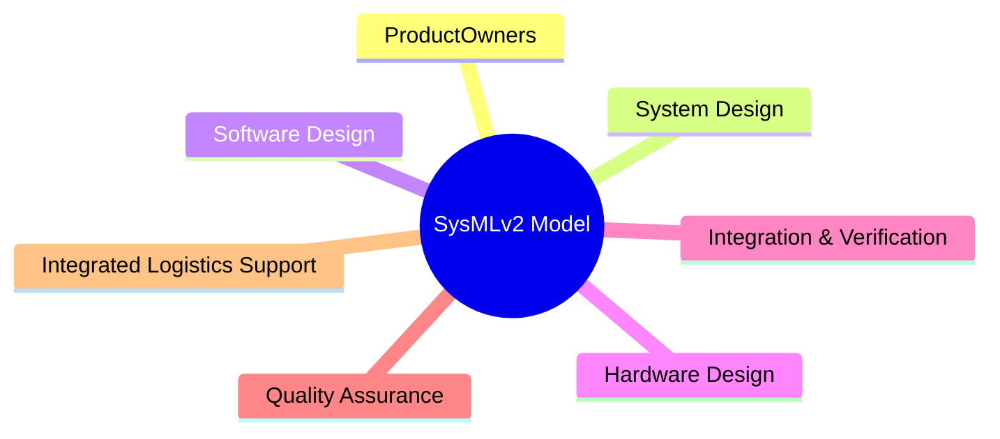

# Introduction to MBSE

## What is MBSE

Model-Based Systems Engineering (MBSE) uses a shared system model as the primary artefact instead of disconnected documents. Requirements, behaviour, architecture, and verification stay linked in one place. This enables multiple diciplines share a common source of truth in a single model.

## Why it pays off in the age of AI

A textual SysML v2 model is a stable context for humans and agents: diffs are reviewable, structure is explicit, and the same files feed documentation, analysis, and tooling. Investing in a clear product structure reduces rework when AI assists with edits and reviews.

## Suggested product and project structure

### Requirements/

`requirements.sysml` with requirement objects grouped in packages by context or type.

### Functions/

Optional step (e.g. Arcadia alignment). `functions.sysml` organises functions into planes such as management, control, user, and infrastructure. Functions specialise parts; planes can be parts. Capture dependencies between functions for a high-level structure view.

### UseCases/

`usecases.sysml` with actors, use case objects, and CaseScenario objects invoked with `then perform <CaseScenario>`. Use cases may also invoke sub-use cases or actions. If Functions are used with an Arcadia-style split, define use cases first, then break some into sub-use cases aligned 1:1 with functions where the use case spans several functions.

### LogicalArchitecture/

Decompose functions into parts (Arcadia), or organise by cohesion: logical modules that realise parts of one or more functions while sharing an information context. A logical module is a part with ports; ports are typed by interfaces. Modules stay implementation-agnostic.

### Dynamics/

Interactions (sequence diagrams) and state machines design the behaviour that realises use cases.

### PhysicalArchitecture/

Map logical components to HW/SW implementation parts, including CI/CD and DevSecOps infrastructure. Deployment views are central here.
