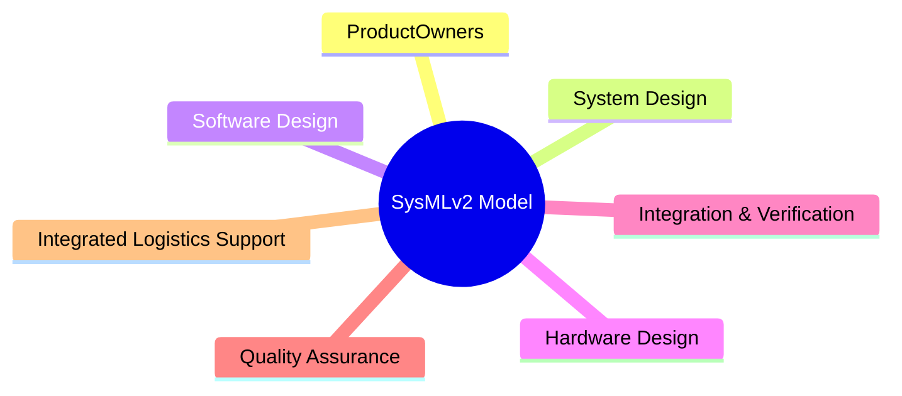
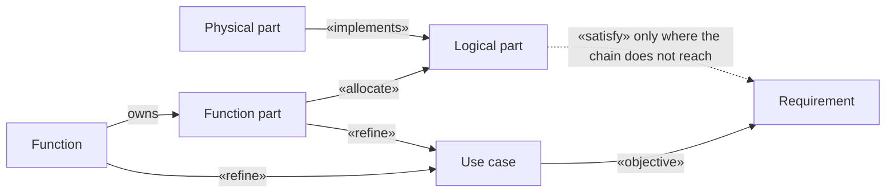
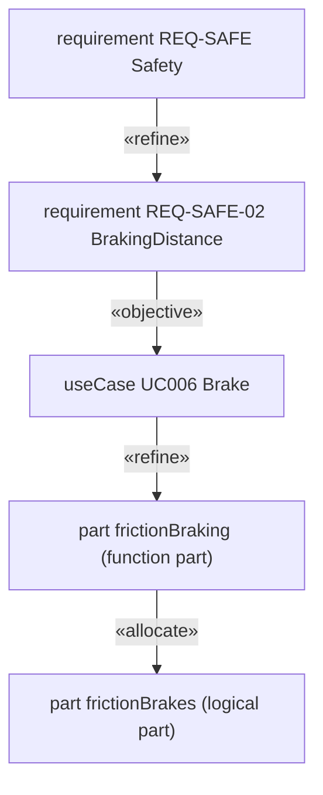

# Introduction to MBSE

## What is MBSE

Model-Based Systems Engineering (MBSE) uses a shared system model as the primary artefact instead of disconnected documents. Requirements, behaviour, architecture, and verification stay linked in one place. This lets several disciplines share a common source of truth in a single model.



## Why it pays off in the age of AI

A textual SysML v2 model is a stable context for humans and agents: diffs are reviewable, structure is explicit, and the same files feed documentation, analysis, and tooling. Investing in a clear product structure reduces rework when AI assists with edits and reviews.

## Suggested product and project structure

Use one package per layer and one folder per package. The order below is the order you model in: each layer refines or realises the one above it, so that every element further down can be traced back to a requirement (see *Modelling for traceability* below). The folder names in brackets are the ones the `electric_car` example uses.

### Requirements/

(`requirements/`) `requirements.sysml` with requirement objects grouped in packages by context or type. Leaf requirements (such as BrakingDistance) refine a group requirement (such as Safety) with `#refine`. User stories are requirements too, and they refine the requirements they are about.

### UseCases/

(`use_cases/`) `use_cases.sysml` with actors and use cases on the system boundary. Each use case names the requirement it must fulfil with `objective` and refines a user story with `#refine`. Describe a use case at least with text (`doc`), and preferably with an activity flow that has alternative paths where they apply. A use case may include other use cases (`include use case`). Its steps can also be written as CaseScenario objects invoked with `then perform <CaseScenario>`; see the tutorial *Use cases and scenarios*.

### Functions/

(`functions/`) `functions.sysml` with the white box functions of the system. This layer is part of the trace, not an optional step. Each function is decomposed into function parts (composition), has at least one activity flow, and refines the use cases it carries out. Every action in a flow is performed by one of the function's parts (`perform`), and every function part is allocated to a logical part. Dependencies between functions (such as «Energy» or «Authorize») give a high-level structure view.

### LogicalArchitecture/

(`logical_architecture/`) Logical parts with ports typed by interfaces, joined by connections. A logical part is synthesised from the function parts allocated to it: it groups the function parts that work on the same information context, possibly from several functions. Decompose a logical part hierarchically where necessary. Logical parts stay implementation-agnostic, and they may `satisfy` requirements that the function chain does not reach, typically non-functional ones.

### Dynamics/

(`dynamics/`) Occurrence defs (sequence diagrams) between the logical parts that realise the use cases, with lifelines that are instances of the logical parts, named after them, and state machines. The internal behaviour of a single part may also be modelled with state machines and activity flows in its part definition.

### PhysicalArchitecture/

(`physical_architecture/`) The software, hardware and, where relevant, mechanical parts that implement the logical parts with «implements», including CI/CD and DevSecOps infrastructure where it is part of the product. A physical part always implements the full scope of a logical part. Deployment views are central here.

Next to the layers, a project holds `views/` (diagram layouts), a `docs/` folder per layer with one markdown file per documented element, and `project.json` and `state.json` at the root.

## Modelling for traceability

This part shows how the artefacts above are modelled so that every element can be traced through the whole model, from a physical part back to the requirement it exists for. All examples come from the `electric_car` example project (open it from **Examples…** in the header).

The concept in one picture. The arrows point the way the SysML relations are written, from source to target:



### 1. Functional requirement refinement: use cases, functions and function parts

#### Use cases

Use cases are typically defined on the system boundary. A use case captures the interaction between a user and the system, and it is triggered by the user or by an event. Describe each use case at least with text, and preferably with an activity flow with alternative paths where that applies.

In `use_cases/use_cases.sysml` the Brake use case has the short name `UC006` (written `<'UC006'>`, the same way requirements have `<'REQ-SAFE-02'>`), so it can be referred to by number; the use cases are numbered UC001 to UC021 in file order. It names its actor, the requirement it must fulfil (`objective`) and a short flow. Each step is declared as an action with its own `doc`, and the flow then orders the steps:

```sysml
use case def <'UC006'> Brake {
  actor Driver;
  objective Requirements::BrakingDistance;
  doc /* The driver presses the brake pedal and the car slows, blending regeneration and friction, with the brake lamps lit. */

  action pressBrake {
    doc /* The driver presses the brake pedal. */
  }
  action applyBrake {
    doc /* The car slows in proportion to pedal travel, recovering energy where it can. */
  }
  action applyBrakeLights {
    doc /* The brake lamps light while the pedal is pressed, so traffic behind sees the car slow down. */
  }
  first start;
  then pressBrake;
  then applyBrake;
  then applyBrakeLights;
  then done;
}
```

The flow of the Charge use case has an alternative path, a loop that keeps charging while the charger stays plugged in (the step declarations are left out):

```sysml
first start;
then connectCharger;
then negotiateSession;
then transferEnergy;
then reportCharge;
// Loop: keep charging while the charger stays plugged in.
then if pluggedIn then transferEnergy else endSession;
first endSession then done;
```

Every use case in the example has such a flow. StartVehicle (UC001), for instance, has two decisions: without the brake held the car asks for the brake, and without an approved key it rejects the start. Double-click a use case in a diagram to see its flow.

A use case also refines the user story it serves:

```sysml
#refine dependency from Brake to Requirements::ControlSpeed;
```

#### Functions and function parts

Functions are part of the white box design, and one function may be involved in several use cases. A function is decomposed into function parts (composition). Each function has at least one activity flow, and the actions in that flow are "allocated" to the function parts with the SysML v2 `perform` statement. In the `electric_car` model the function parts are called functional entities and are typed by `FunctionNode`.

From `functions/functions.sysml` (shortened; `// …` marks left-out lines):

```sysml
part def SpeedControl :> Function {
  part torqueArbitration : FunctionNode {
    perform speedControlFlow.arbitrateTorque;
  }
  part regenBlending : FunctionNode {
    perform speedControlFlow.blendRegen;
  }
  // …
  part frictionBraking : FunctionNode {
    doc /* Apply hydraulic brake pressure, with anti-lock modulation in an emergency stop. Allocated to the friction brakes. */
    perform speedControlFlow.applyFriction;
  }
  action speedControlFlow {
    // …
    first start;
    then arbitrateTorque;
    then if braking then blendRegen else driveWheels;
    first blendRegen then applyFriction;
    first applyFriction then done;
    first driveWheels then done;
  }
}
```

A function, and each of its function parts, refines the use cases it carries out. SpeedControl takes part in Accelerate, Brake and EmergencyStop, and Brake is also refined by Lighting, which lights the brake lamps:

```sysml
#refine dependency from Functions::SpeedControl to UseCases::Driving::Brake;
#refine dependency from Functions::Lighting to UseCases::Driving::Brake;
#refine dependency from Functions::SpeedControl::frictionBraking to UseCases::Driving::Brake;
#refine dependency from Functions::SpeedControl::frictionBraking to UseCases::Driving::EmergencyStop;
```

#### Function parts are allocated to logical parts

Function parts are «allocated» to logical parts of the logical architecture. This lets one logical part aggregate several functions, which simplifies the interface structure of the system and allows efficient operations on the same data context. In other words, it applies good system design practice.

In the example the drive controller aggregates two function parts of SpeedControl and two of Maneuvrability, because they all work on pedal, gear and steering data:

```sysml
allocate SpeedControl::torqueArbitration to LogicalArchitecture::Car::driveController;
allocate SpeedControl::regenBlending to LogicalArchitecture::Car::driveController;
allocate SpeedControl::frictionBraking to LogicalArchitecture::Car::frictionBrakes;
allocate Maneuvrability::steeringControl to LogicalArchitecture::Car::driveController;
allocate Maneuvrability::gearSelection to LogicalArchitecture::Car::driveController;
```

The view **FunctionAllocationView** shows these allocations. One flow view per function flow (for example **SpeedControlFlowView**) shows each step with the function part that performs it.

### 2. Logical and physical architecture with dynamics

#### Logical parts, ports and interfaces

Logical parts are modelled with formal ports and interfaces that capture the information exchanged between the parts. Logical parts may be decomposed hierarchically where necessary.

From `logical_architecture/car.sysml` (shortened):

```sysml
interface def BrakeCommand {
  doc /* Friction brake pressure after regen blending. The drive controller provides it and the friction brakes consume it. */
}

part def Car {
  part driveController {
    // …
    port brakeCommandOut : BrakeCommand;
  }
  part frictionBrakes {
    port brakeCommandIn : BrakeCommand;
  }
  connection brake connect driveController.brakeCommandOut to frictionBrakes.brakeCommandIn;
}
```

- **Connections** join ports on the same hierarchical level. The connection `brake` above joins two parts that are both directly inside Car.
- **Bindings** state that ports on different hierarchical levels have the same purpose and implement the same interface port. The logical car in the example is flat, so this example comes from the physical architecture, where the drive computer `driveEcu` exposes a port of the software it hosts:

  ```sysml
  part driveEcu {
    // …
    port brakeCommandOut : BrakeCommand;
    part driveControlSw {
      // …
      port brakeCommandOut : BrakeCommand;
    }
  }
  bind driveEcu.brakeCommandOut = driveEcu.driveControlSw.brakeCommandOut;
  ```

- **Logical parts may satisfy requirements.** These are typically non-functional requirements, including requirements that set constraints on functions:

  ```sysml
  satisfy Range by LogicalArchitecture::Car::battery;
  satisfy BrakingDistance by LogicalArchitecture::Car::brakePedal;
  ```

#### Dynamics

The dynamics between parts are defined as sequence diagrams in the Dynamics part of the model. Each sequence is an `occurrence def`, and its lifelines are `ref part`s typed by the logical part definitions and named like the logical parts, so the sequences and the logical architecture read as one model. From `dynamics/sequences.sysml` (shortened):

[//]: # (source: examples/electric_car/dynamics/sequences.sysml)
```sysml
occurrence def BrakeSequence {
  ref part Driver : Driver;
  ref part brakePedal : BrakePedal;
  ref part driveController : DriveController;
  // …
  ref part frictionBrakes : FrictionBrakes;
  ref part wheels : Wheels;
  // …
  message pressPedal from Driver to brakePedal;
  message decelerationRequest from brakePedal to driveController;
  // …
  message frictionPressure from driveController to frictionBrakes;
  message brakingForce from frictionBrakes to wheels;
  #Reply message wheelSpeed from wheels to driveController;
  #Reply message pedalFeedback from brakePedal to Driver;
}
```

The internal behaviour of a part may be modelled with state machines and activity flows in the part definition. The example keeps the modes of the whole car as a state machine in Dynamics, and every sequence states the mode it starts and ends in:

```sysml
state def VehicleModes {
  state Locked;
  state Unlocked;
  state Ready;
  // …
  transition unlock from Locked to Unlocked;
  transition startVehicle from Unlocked to Ready;
  // …
}
```

#### Physical architecture

The physical architecture parts represent the actual implementation objects: software, hardware and, where relevant, mechanics. A physical part «implements» one or more logical parts. A physical part must always implement the full scope of a logical part. That is one reason why logical parts may need to be decomposed into more detailed parts: if only a piece of a logical part would end up in an implementation object, split the logical part first.

From `physical_architecture/vehicle_physical.sysml`:

```sysml
#implements dependency from vehicleEcu to LogicalArchitecture::Car::vehicleController;
#implements dependency from vehicleEcu.vehicleControlSw to LogicalArchitecture::Car::vehicleController;
#implements dependency from infotainmentEcu to LogicalArchitecture::Car::entertainmentSystem, LogicalArchitecture::Car::climateSystem;
#implements dependency from brakeCaliperAsm to LogicalArchitecture::Car::frictionBrakes;
```

`infotainmentEcu` hosts two whole logical parts, the entertainment system and the climate system, and implements both. The view **PhysicalDependenciesView** shows all «implements» dependencies.

### 3. Traceability

By following the concept above, SysML Viewer can trace the leaf elements back to the requirements.

#### The dependency tree

Select an element, in a diagram or in the Model tree, and click the **dependency tree** button: the tree icon next to the **Details** heading in the right sidebar. The use case dialog has the same button in its header. The dialog shows two things:

- **Up**, at the top: one chain from the most abstract element down to the selected element. Each step is labelled with the relation to the element below it. The chain prefers trace relations (`satisfy`, `refine`, `derive`, `objective`, `implements`), then `allocate`, then ownership and typing. A badge such as **+2** tells how many other candidates there were at that level; the chain follows only one.
- **Down**, from the selected element: everything that depends on it, as a tree. **↺** marks an element that is already shown elsewhere in the tree, and **…** marks a branch that was cut off at the depth or size limit.

Click any element in the tree to open its details.

#### A chain from a logical part

Open **CarLogicalView**, select `frictionBrakes` and open its dependency tree. The Up chain reads:



The arrows here follow the dialog, from the more abstract element to the less abstract one. In the model the relations are written the other way round, except `allocate`: frictionBraking is allocated to frictionBrakes, frictionBraking refines Brake, Brake has BrakingDistance as its objective, and BrakingDistance refines Safety. Down from `frictionBrakes` the tree continues with the physical part that implements it, `brakeCaliperAsm`, and with the parts that depend on it.

#### A chain from a physical part

The same works from the physical side. Select `vehicleEcu` in **PhysicalView** and open its dependency tree. The chain climbs through «implements» into the logical architecture and on to a requirement:

| Step | Element | Relation to the next step |
|------|---------|---------------------------|
| 1 | requirement REQ-PERF Performance | «refine» |
| 2 | requirement REQ-PERF-06 PowerModes | «objective» |
| 3 | useCase UC001 StartVehicle | «refine» |
| 4 | part authenticate (function part) | «allocate» |
| 5 | part vehicleController (logical part) | «implements» |
| 6 | part vehicleEcu (physical part, selected) | |

Several steps carry a **+N** badge. `vehicleController` has three function parts allocated to it (authenticate, immobilizer and wakeUp), and they serve several use cases, so there is more than one way up; the chain shows one of them.

#### When to use satisfy

`satisfy` is used only where the chain does not reach the part. The `electric_car` requirements file says so above its satisfy statements:

```sysml
// Direct satisfy only where the function chain does not reach the part.
satisfy VehicleLength by LogicalArchitecture::Car::body;
// …
satisfy CrashProtection by LogicalArchitecture::Car::body;
// …
satisfy BrakingDistance by LogicalArchitecture::Car::brakePedal;
```

The body has no function parts allocated to it, so no use case leads to it, and the size and crash requirements are satisfied directly. BrakingDistance is already traced through the Brake use case to the drive controller and the friction brakes, but not to the brake pedal, so only the pedal gets a satisfy. The reason is that each trace should be stated once. A satisfy that repeats what the function chain already says is a second statement of the same fact: it can drift from the chain when the model changes, and it hides which part actually realises the requirement.
