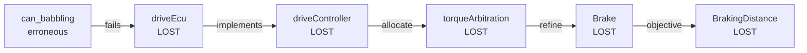
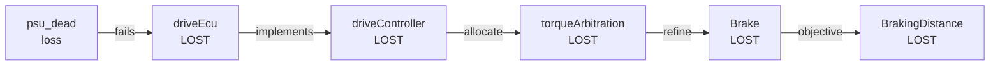

# FMEA report: Electric Car

## Summary

- Mode: fmea
- Items: 5, failure modes: 7, single points of failure: 3
- Highest RPN: 200 (winding_open)
- Coverage: 5 of 39 physical parts have failure modes

## Top risks

| Item | Qty | Failure mode | S | O | D | RPN |
|---|---|---|---|---|---|---|
| electricMotor | 1 | winding_open | 10 | 4 | 5 | 200 |
| driveEcu | 1 | can_babbling | 10 | 3 | 4 | 120 |
| batteryPack.modules | 8 | cell_short | 6 | 5 | 3 | 90 |
| infotainmentEcu | 1 | soc_lockup | 3 | 5 | 6 | 90 |
| batteryPack.modules | 8 | capacity_fade | 6 | 6 | 2 | 72 |

## Single points of failure

| Item | Failure mode | S | Lost functions | Requirements at risk |
|---|---|---|---|---|
| electricMotor | winding_open | 10 | Lighting; Maneuvrability; SpeedControl; WindshieldCleaning | Acceleration; BrakingDistance; DirectionalControl; ForwardVisibility; NightVisibility; PropulsionModes; Range; TopSpeed |
| driveEcu/canTransceiver | can_babbling | 10 | Lighting; Maneuvrability; SpeedControl; WindshieldCleaning | Acceleration; BrakingDistance; DirectionalControl; ForwardVisibility; NightVisibility; PropulsionModes; Range; TopSpeed |
| driveEcu/powerSupply | psu_dead | 10 | Lighting; Maneuvrability; SpeedControl; WindshieldCleaning | Acceleration; BrakingDistance; DirectionalControl; ForwardVisibility; NightVisibility; PropulsionModes; Range; TopSpeed |

## Criticality matrix

Severity (S) by occurrence (O):

| S | 3 | 4 | 5 | 6 |
|---|---|---|---|---|
| 10 | can_babbling, psu_dead | winding_open |  |  |
| 6 |  |  | cell_short | capacity_fade |
| 3 |  |  | soc_lockup |  |
| 1 | hydraulic_leak |  |  |  |

## Effect chains

### electricMotor: winding_open (S = 10)

```mermaid
flowchart LR
    m_winding_open["winding_open<br/>loss"]
    n0_electricMotor["electricMotor<br/>LOST"]
    n1_engine["engine<br/>LOST"]
    n2_tractionDrive["tractionDrive<br/>LOST"]
    n3_SpeedControl["SpeedControl<br/>LOST"]
    n4_Brake["Brake<br/>LOST"]
    n5_BrakingDistance["BrakingDistance<br/>LOST"]
    m_winding_open -->|fails| n0_electricMotor
    n0_electricMotor -->|implements| n1_engine
    n1_engine -->|allocate| n2_tractionDrive
    n2_tractionDrive -->|node| n3_SpeedControl
    n3_SpeedControl -->|refine| n4_Brake
    n4_Brake -->|objective| n5_BrakingDistance
```

### driveEcu: can_babbling (S = 10)

### driveEcu: psu_dead (S = 10)

## Coverage

Physical parts without failure modes:

- VehiclePhysical::vehicleEcu
- VehiclePhysical::vehicleEcu::vehicleControlSw
- VehiclePhysical::driveEcu::driveControlSw
- VehiclePhysical::bodyEcu
- VehiclePhysical::bodyEcu::bodyControlSw
- VehiclePhysical::infotainmentEcu::entertainmentSw
- VehiclePhysical::infotainmentEcu::climateControlSw
- VehiclePhysical::engineEcu
- VehiclePhysical::engineEcu::engineControlSw
- VehiclePhysical::batteryEcu
- VehiclePhysical::batteryEcu::batteryControlSw
- VehiclePhysical::keyFobUnit
- VehiclePhysical::startButtonMech
- VehiclePhysical::steeringWheelMech
- VehiclePhysical::gearStickMech
- VehiclePhysical::acceleratorPedalMech
- VehiclePhysical::brakePedalMech
- VehiclePhysical::instrumentClusterUnit
- VehiclePhysical::hvacAssembly
- VehiclePhysical::displayAndSpeakers
- VehiclePhysical::batteryPack
- VehiclePhysical::chassisFrame
- VehiclePhysical::wheelSet
- VehiclePhysical::brakeCaliperAsm
- VehiclePhysical::suspensionAsm
- VehiclePhysical::doorAsm
- VehiclePhysical::windowAsm
- VehiclePhysical::windowLiftAsm
- VehiclePhysical::bodyShell
- VehiclePhysical::windshieldGlass
- VehiclePhysical::wiperAsm
- VehiclePhysical::doorLockAsm
- VehiclePhysical::lampUnits
- VehiclePhysical::chargeInletMech

## Files

The data of this report, in the same folder next to this report. They are plain files, not links: open them in your editor (the viewer cannot show CSV).

- `fmea-table.csv`
- `fmea-spof.csv`
- `coverage.csv`
