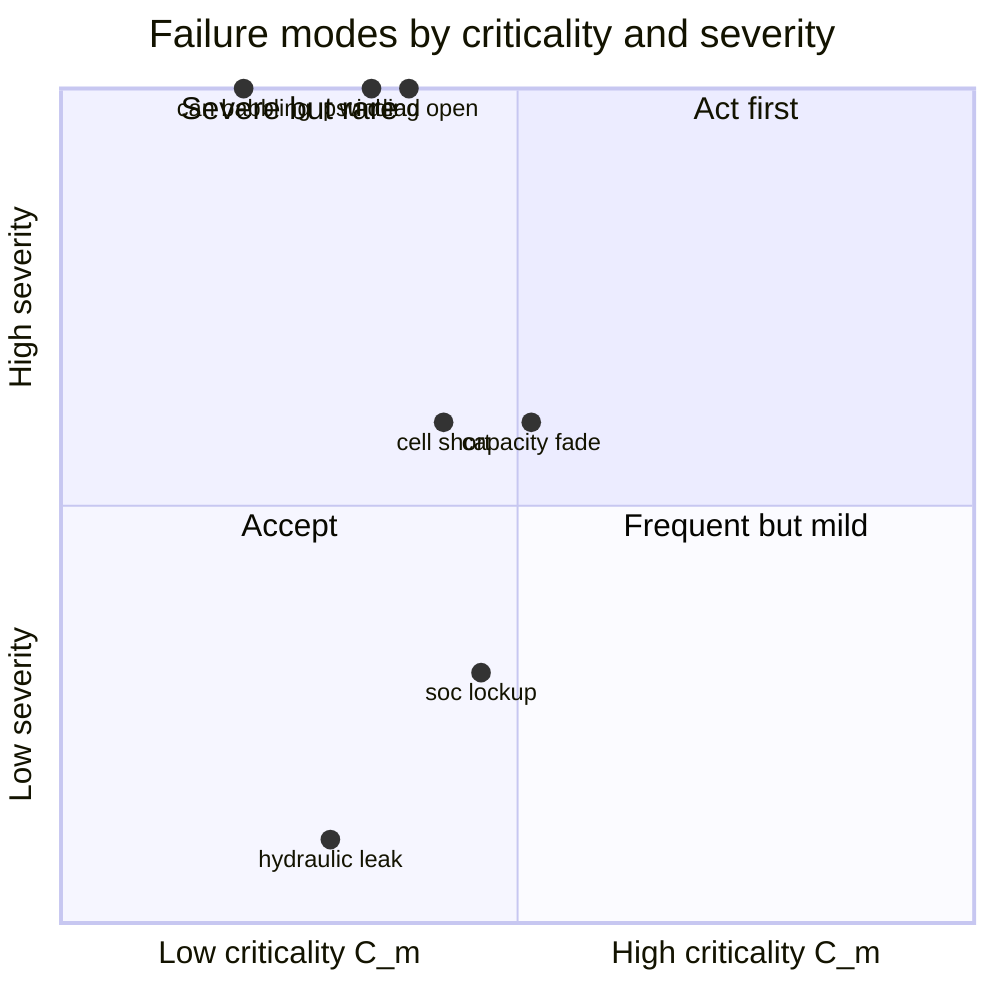

# FMECA report: Electric Car

## Summary

- Mode: fmeca
- Items: 5, failure modes: 7, single points of failure: 3
- Highest criticality C_m: 3.8e-03 (capacity_fade)
- Coverage: 5 of 39 physical parts have failure modes

## Top risks

| Item | Failure mode | S | Criticality | Severity class | Probability level |
|---|---|---|---|---|---|
| electricMotor | winding_open | 10 | 8.0e-04 | I | E |
| driveEcu | psu_dead | 10 | 5.0e-04 | I | E |
| driveEcu | can_babbling | 10 | 1.0e-04 | I | E |
| batteryPack.modules | capacity_fade | 6 | 3.8e-03 | III | D |
| batteryPack.modules | cell_short | 6 | 1.3e-03 | III | D |

## Single points of failure

| Item | Failure mode | S | Lost functions | Requirements at risk |
|---|---|---|---|---|
| electricMotor | winding_open | 10 | Lighting; Maneuvrability; SpeedControl; WindshieldCleaning | Acceleration; BrakingDistance; DirectionalControl; ForwardVisibility; NightVisibility; PropulsionModes; Range; TopSpeed |
| driveEcu/powerSupply | psu_dead | 10 | Lighting; Maneuvrability; SpeedControl; WindshieldCleaning | Acceleration; BrakingDistance; DirectionalControl; ForwardVisibility; NightVisibility; PropulsionModes; Range; TopSpeed |
| driveEcu/canTransceiver | can_babbling | 10 | Lighting; Maneuvrability; SpeedControl; WindshieldCleaning | Acceleration; BrakingDistance; DirectionalControl; ForwardVisibility; NightVisibility; PropulsionModes; Range; TopSpeed |

## Criticality matrix

Severity class:

| Class | A | B | C | D | E |
|---|---|---|---|---|---|
| I |  |  |  |  | winding_open, psu_dead, can_babbling |
| II |  |  |  |  |  |
| III |  |  |  | capacity_fade, cell_short |  |
| IV |  |  |  | soc_lockup | hydraulic_leak |

## Effect chains

### electricMotor: winding_open (S = 10)

### driveEcu: psu_dead (S = 10)

### driveEcu: can_babbling (S = 10)

## Coverage

Physical parts without failure modes:

- VehiclePhysical::vehicleEcu
- VehiclePhysical::vehicleEcu::vehicleControlSw
- VehiclePhysical::driveEcu::driveControlSw
- VehiclePhysical::bodyEcu
- VehiclePhysical::bodyEcu::bodyControlSw
- VehiclePhysical::infotainmentEcu::entertainmentSw
- VehiclePhysical::infotainmentEcu::climateControlSw
- VehiclePhysical::engineEcu
- VehiclePhysical::engineEcu::engineControlSw
- VehiclePhysical::batteryEcu
- VehiclePhysical::batteryEcu::batteryControlSw
- VehiclePhysical::keyFobUnit
- VehiclePhysical::startButtonMech
- VehiclePhysical::steeringWheelMech
- VehiclePhysical::gearStickMech
- VehiclePhysical::acceleratorPedalMech
- VehiclePhysical::brakePedalMech
- VehiclePhysical::instrumentClusterUnit
- VehiclePhysical::hvacAssembly
- VehiclePhysical::displayAndSpeakers
- VehiclePhysical::batteryPack
- VehiclePhysical::chassisFrame
- VehiclePhysical::wheelSet
- VehiclePhysical::brakeCaliperAsm
- VehiclePhysical::suspensionAsm
- VehiclePhysical::doorAsm
- VehiclePhysical::windowAsm
- VehiclePhysical::windowLiftAsm
- VehiclePhysical::bodyShell
- VehiclePhysical::windshieldGlass
- VehiclePhysical::wiperAsm
- VehiclePhysical::doorLockAsm
- VehiclePhysical::lampUnits
- VehiclePhysical::chargeInletMech

## Simulation

2000 trials, seed 1, mission time 10000 h. Nodes that are never affected are left out; see simulation.csv for all.

| Node | Layer | P(LOST) | P(DEGRADED) |
|---|---|---|---|
| Functions::Charging | function | 0.0000 | 0.0470 |
| Functions::Climate | function | 0.0015 | 0.0470 |
| Functions::Entertainment | function | 0.0015 | 0.0470 |
| Functions::Lighting | function | 0.0010 | 0.0470 |
| Functions::Maneuvrability | function | 0.0010 | 0.0470 |
| Functions::SpeedControl | function | 0.0010 | 0.0470 |
| Functions::WindshieldCleaning | function | 0.0010 | 0.0470 |
| UseCases::Driving::Accelerate | useCase | 0.0010 | 0.0470 |
| UseCases::Driving::Brake | useCase | 0.0010 | 0.0470 |
| UseCases::Driving::ChangeGear | useCase | 0.0010 | 0.0470 |
| UseCases::Driving::CleanWindshield | useCase | 0.0010 | 0.0470 |
| UseCases::Driving::Drive | useCase | 0.0010 | 0.0470 |
| UseCases::Driving::EmergencyStop | useCase | 0.0010 | 0.0470 |
| UseCases::Driving::ToggleHeadlights | useCase | 0.0010 | 0.0470 |
| UseCases::Driving::TurnLeft | useCase | 0.0010 | 0.0470 |
| UseCases::Driving::TurnRight | useCase | 0.0010 | 0.0470 |
| UseCases::Managing::AdjustClimate | useCase | 0.0015 | 0.0470 |
| UseCases::Managing::Charge | useCase | 0.0000 | 0.0470 |
| UseCases::Managing::PlayMedia | useCase | 0.0015 | 0.0470 |
| Requirements::Acceleration | requirement | 0.0010 | 0.0470 |
| Requirements::BrakingDistance | requirement | 0.0010 | 0.0470 |
| Requirements::CabinClimate | requirement | 0.0015 | 0.0470 |
| Requirements::CabinMedia | requirement | 0.0015 | 0.0470 |
| Requirements::ChargeTime | requirement | 0.0000 | 0.0470 |
| Requirements::DirectionalControl | requirement | 0.0010 | 0.0470 |
| Requirements::ForwardVisibility | requirement | 0.0010 | 0.0470 |
| Requirements::NightVisibility | requirement | 0.0010 | 0.0470 |
| Requirements::PropulsionModes | requirement | 0.0010 | 0.0470 |
| Requirements::Range | requirement | 0.0010 | 0.0470 |
| Requirements::TopSpeed | requirement | 0.0010 | 0.0470 |

## Files

- [fmeca-table.csv](fmeca-table.csv)
- [spof.csv](spof.csv)
- [coverage.csv](coverage.csv)
- [simulation.csv](simulation.csv)
